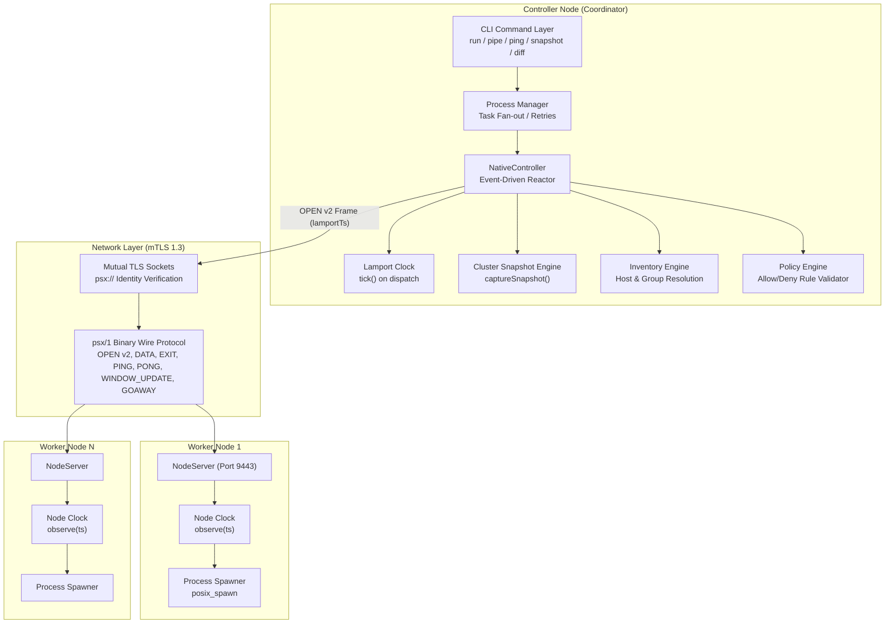
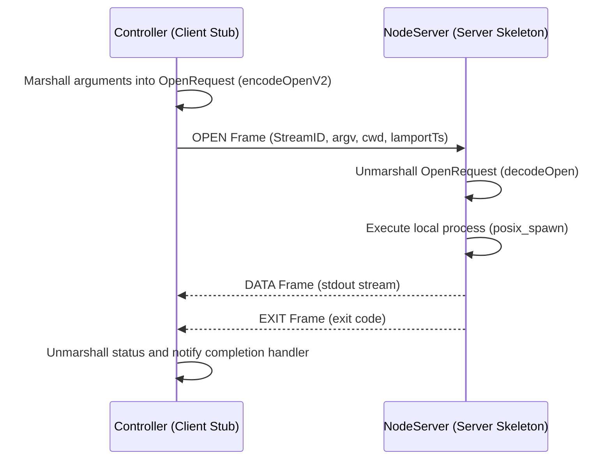

# Distributed Systems Concepts in PipeShellX — In-Depth Architectural Guide

This document presents a comprehensive, rigorous academic and systems analysis of the **Distributed Systems (DS)** concepts implemented in PipeShellX. It serves as an authoritative reference mapping the codebase against standard university distributed systems curricula (e.g., Tanenbaum & Van Steen, Coulouris et al.), structured across the four classic syllabus units.

---

## Table of Contents
1. [System Architectural Classification](#1-system-architectural-classification)
2. [Unit I: System Models, Goals & Middleware](#2-unit-i-system-models-goals--middleware)
3. [Unit II: Distributed Communication, RPC & Protocols](#3-unit-ii-distributed-communication-rpc--protocols)
4. [Unit III: Synchronization, Logical Clocks & Global State](#4-unit-iii-synchronization-logical-clocks--global-state)
5. [Unit IV: Emerging Distributed Paradigms](#5-unit-iv-emerging-distributed-paradigms)
6. [Comprehensive Syllabus Mapping Matrix](#6-comprehensive-syllabus-mapping-matrix)

---

## 1. System Architectural Classification

PipeShellX is an open-source, production-grade distributed shell and pipeline execution platform. Rather than simulating distributed phenomena on a single thread or relying on synthetic mocks, PipeShellX **is inherently a distributed system**.



### Architectural Models Present in PipeShellX:
1. **Master-Worker (Coordinator-Worker):** The central [`NativeController`](file:///c:/Users/raman/Desktop/trainer%20module/PipeShellX/src/transport/native_controller.cpp) acts as the coordinator responsible for dispatching commands, monitoring liveness, and recording state, while decentralized [`NodeServer`](file:///c:/Users/raman/Desktop/trainer%20module/PipeShellX/src/transport/node_server.cpp) instances act as execution workers. This mirrors production distributed systems like Google Borg, Kubernetes, and Hadoop MapReduce.
2. **Star Topology:** In the control plane, all worker nodes establish point-to-point connections with the controller.
3. **Pipeline DAG (Directed Acyclic Graph):** In stage execution mode ([`dag_runner.cpp`](file:///c:/Users/raman/Desktop/trainer%20module/PipeShellX/src/pipeline/dag_runner.cpp) and [`distributed_runner.cpp`](file:///c:/Users/raman/Desktop/trainer%20module/PipeShellX/src/pipeline/distributed_runner.cpp)), tasks form a topological execution graph where outputs of upstream workers feed downstream worker stages.

---

## 2. Unit I: System Models, Goals & Middleware

### 2.1 Characterization of a Distributed System
A distributed system consists of autonomous computing entities that communicate over a network and coordinate their actions by passing messages, appearing to users as a single coherent facility. PipeShellX satisfies all formal criteria:
- **Autonomous Nodes:** Controller and worker nodes run as distinct processes, potentially on disparate hardware, OS kernels, and geographical locations.
- **No Shared Memory:** State is never shared through raw memory pointers. All coordination occurs strictly through serialized message passing over TCP/TLS sockets.
- **Independent Failure Modes:** The failure or network partition of an individual worker node does not cause the controller to abort other executions unless explicitly requested via failure policies.
- **Concurrency:** Dispatches to multiple worker nodes execute concurrently on distinct physical CPUs.

### 2.2 Distributed Systems Goals & Transparencies
PipeShellX explicitly implements the core DS goals defined by ISO/IEC 10746 (RM-ODP):

| Goal / Transparency | Theoretical Definition | PipeShellX Implementation | Source Code |
|---|---|---|---|
| **Location Transparency** | Clients access resources without knowledge of physical location | Nodes are addressed using logical hostnames, groups, or tags in the inventory rather than hardcoded IP addresses. | [`inventory.cpp`](file:///c:/Users/raman/Desktop/trainer%20module/PipeShellX/src/inventory/inventory.cpp) |
| **Access Transparency** | Identical syntax and operations regardless of whether execution is local or remote | The `pipeshellx run` CLI offers the same invocation flags whether targeting a local worker or remote native transport nodes. | [`run_command.cpp`](file:///c:/Users/raman/Desktop/trainer%20module/PipeShellX/src/cli/run_command.cpp) |
| **Failure Transparency** | Masking faults from users | Connection retries (`--retries N`), idempotent execution guards (`--idempotent`), and failover recovery hide transient drops. | [`process_manager.cpp`](file:///c:/Users/raman/Desktop/trainer%20module/PipeShellX/src/process_manager.cpp) |
| **Concurrency Transparency** | Multiple tasks execute without mutual interference | Single-threaded event-driven reactor manages bounded concurrent connections (`-c N`) with distinct stream IDs. | [`reactor.cpp`](file:///c:/Users/raman/Desktop/trainer%20module/PipeShellX/src/runtime/reactor.cpp) |
| **Heterogeneity Support** | Interoperability across differing OS and hardware architectures | An OS abstraction layer with POSIX backends for Linux (epoll, pidfd, signalfd), macOS/BSD (kqueue) and a portable `poll` fallback. A Windows controller/node is **not** implemented (the build stops on Windows; see ROADMAP.md). | [`src/os/`](file:///c:/Users/raman/Desktop/trainer%20module/PipeShellX/src/os) |
| **Openness** | Extensibility through published, standard interfaces | Formal specification of the `psx/1` binary wire protocol and versioned message framing. | [`docs/wire_protocol.md`](file:///c:/Users/raman/Desktop/trainer%20module/PipeShellX/docs/wire_protocol.md) |
| **Scalability** | Handling increased load without degradation | Credit-based flow control, ring buffers with configurable drop policies, and non-blocking I/O backends (`epoll`, `kqueue`, `poll`). | [`credit_window.cpp`](file:///c:/Users/raman/Desktop/trainer%20module/PipeShellX/src/stream/credit_window.cpp) |

### 2.3 The Middleware Layer
PipeShellX operates as classical **systems middleware**. It abstracts low-level socket lifecycles, TLS 1.3 handshake negotiation, data marshalling, and OS process spawning behind high-level cluster coordination primitives.

---

## 3. Unit II: Distributed Communication, RPC & Protocols

### 3.1 Layered Binary Wire Protocol (`psx/1`)
Communication between controller and nodes conforms to the `psx/1` binary application protocol. All transmissions are formatted into structured Type-Length-Value (TLV) frames.

#### Frame Layout (10-Byte Header)
Every frame is a fixed 10-byte header followed by the payload (all integers
big-endian; see `docs/wire_protocol.md`, the authoritative spec). There is no
magic number or per-frame version: versioning lives inside structured
payloads such as OPEN.

| Offset | Size | Field | Meaning |
| ---: | ---: | --- | --- |
| 0 | 1 | `type` | Frame type (1-7, below) |
| 1 | 1 | `flags` | `0x01` END_STREAM, `0x02` STDERR (on DATA) |
| 2 | 4 | `stream_id` | Stage stream; `0` for connection frames (PING/PONG/GOAWAY) |
| 6 | 4 | `length` | Payload byte count (max 16 MiB) |
| 10 | `length` | `payload` | Type-specific bytes |

#### Protocol Frame Types
1. **`OPEN` (Type 1):** Initiates remote stage execution. Carries command `argv`, `cwd`, and in **v2**, the `lamportTs`.
2. **`DATA` (Type 2):** Streams chunks of `stdout` or `stderr` output back to the controller.
3. **`WINDOW_UPDATE` (Type 3):** Grants credit allowances for flow control.
4. **`EXIT` (Type 4):** Signals completion of a stage along with the process exit code.
5. **`PING` (Type 5):** Heartbeat probe; either peer may send it. Any valid frame proves liveness.
6. **`PONG` (Type 6):** Liveness confirmation echoed by the worker.
7. **`GOAWAY` (Type 7):** Graceful connection teardown frame.

### 3.2 Remote Procedure Call (RPC) Pattern
PipeShellX implements the Remote Procedure Call paradigm over its message-oriented wire format:



- **Client Stub:** Implemented in [`NativeController::launch()`](file:///c:/Users/raman/Desktop/trainer%20module/PipeShellX/src/transport/native_controller.cpp#L214). It packages execution parameters, serializes them via [`encodeOpenV2()`](file:///c:/Users/raman/Desktop/trainer%20module/PipeShellX/src/transport/open_request.cpp), and transmits the frame.
- **Server Skeleton:** Implemented in [`NodeStageRunner::onOpen()`](file:///c:/Users/raman/Desktop/trainer%20module/PipeShellX/src/transport/node_stage_runner.cpp#L44). It decodes the payload, validates constraints, and executes the target process.
- **Invocation Semantics:**
  - **At-Most-Once:** Default behavior; commands are not blindly retried upon network drops to avoid non-idempotent side effects.
  - **At-Least-Once:** Enabled via `--retries N --idempotent` when commands are known to be idempotent. This exists on the SSH transport only; the native `psx/1` transport is strictly at-most-once (no reconnect/resume).

### 3.3 Stream-Oriented Communication & Flow Control
To prevent fast worker nodes from exhausting the controller's memory buffer, PipeShellX uses **credit-based sliding window flow control** similar to HTTP/2 and QUIC:
- Each stream maintains a [`CreditWindow`](file:///c:/Users/raman/Desktop/trainer%20module/PipeShellX/include/psx/stream/credit_window.hpp).
- Senders may only transmit `DATA` bytes up to their current available credit balance.
- As the receiver consumes data, it transmits `WINDOW_UPDATE` frames replenishing sender credit.
- Buffers utilize bounded ring buffers with explicit overflow policies: `Block`, `DropOldest`, or `DropNewest`.

### 3.4 Fault Tolerance & Failure Detection
- **Liveness Probing (Heartbeats):** Both peers send `PING` every 2 s; three silent intervals (~6 s) expire the lease and tear the connection down. On the node this also kills (fences) every stage the lost controller owned.
- **Connection Fencing:** Detects and closes dead sockets, preventing "zombie" workers from holding controller resources.
- **Fail-Fast Policy:** When `--fail-fast` is passed, the first node that reports a non-zero exit code or network fault causes the controller to immediately issue cancellation signals to all other in-flight stages.
- **Canary Deployments:** Via `--canary N`, execution tests a small subset of nodes first. Only upon verified success is the rollout dispatched to the remainder of the cluster.

### 3.5 Distributed Security Architecture
Distributed systems are vulnerable to eavesdropping, tampering, and impersonation. PipeShellX establishes a zero-trust network boundary using:
- **Mutual TLS 1.3 (mTLS):** Both controller and worker present X.509 certificates during handshake.
- **Subject Alternative Name (SAN) Identity Verification:** A node started with `--allow psx://controller` rejects any other SAN after the handshake; a controller pins each node's expected SAN from the inventory (`san=`).
- **Policy Enforcement:** An independent policy engine ([`src/policy/`](file:///c:/Users/raman/Desktop/trainer%20module/PipeShellX/src/policy)) inspects commands against administrative allow/deny lists before dispatch.

---

## 4. Unit III: Synchronization

Every mechanism in this section is implemented, unit-tested, and demonstrable.
"Simplified" and "not implemented" are stated where they apply; see
`07-security-review.md` for residual limits.

| Concept | Status | Where | Demo |
| --- | --- | --- | --- |
| Clock synchronization (physical) | Not needed, argued below | n/a | slide only |
| Logical clocks / Lamport's algorithm | Implemented (controller → node) | `runtime/lamport_clock.hpp`, OPEN v2 | `snapshot dump`, `node status` |
| Global state | Implemented, simplified (local state only) | `runtime/cluster_snapshot.*` | `run --snapshot-file`, `snapshot dump` |
| Vector clocks | Not implemented, argued below | n/a | slide only |
| Election algorithm | Implemented: Bully + epochs | `election/bully.*` | `pipeshellx sim election` |
| Mutual exclusion | Implemented: Ricart-Agrawala | `sync/ricart_agrawala.*` | `pipeshellx sim mutex` |
| Beacon protocol | Implemented twice: transport lease (PING/PONG) and the election leader beacon | `transport/native_transport`, `election/bully.*` | kill a node / kill the leader |
| Self-study: fair mutual exclusion | RA grants in (Lamport ts, id) order; checked by property tests | `sync/ricart_agrawala.*` | `sim mutex` fairness line |
| Self-study: deadlock detection | Not needed, argued below | n/a | slide only |

### 4.1 Why physical clock synchronization is not needed

Every node has its own oscillator, which drifts, and NTP adjustments can move a
clock backwards. PipeShellX never orders events by wall-clock time across
machines. Timestamps in snapshots and audit records (`ts_epoch_ms`, `ts_ms`) are
for humans only; ordering uses Lamport time. NTP is therefore an operational
nicety (readable logs), not a correctness requirement. Cristian's and Berkeley
algorithms would solve a problem this design deliberately does not have.

### 4.2 Lamport logical clocks

`psx::runtime::LamportClock` implements the two rules:

- **Local event or send:** `L = L + 1` (`tick()`).
- **Receive of timestamp T:** `L = max(L, T) + 1` (`observe()`).

Both rules give `a → b ⇒ L(a) < L(b)`.

How it flows:

1. `NativeController` and `DistributedRunner` tick their clock for every stage
   they dispatch and put the value in the OPEN v2 payload (8 bytes, big-endian;
   see `docs/wire_protocol.md`).
2. The node observes the value. All of a node's connections share **one**
   clock, owned by `NodeServer`, because a Lamport clock belongs to a process.
   An earlier version had one clock per connection; that was a bug, fixed in
   DS-02.
3. `HostResult::lamportTs`, the snapshot's `lamport_ts`, and `node status`
   (`lamport_clock`) expose the values.

The clock saturates at `2^64-1` instead of wrapping (DS-01), so a hostile
`lamportTs` cannot reset a node's clock.

**Limits:**

- Timestamps flow controller → node only; `EXIT` is fixed at 5 bytes, so
  nothing comes back.
- Lamport time gives a partial order. Two events with the same value are
  concurrent or unrelated. Where a total order is needed (Ricart-Agrawala), ties
  are broken by node id: `(ts, id)`.

### 4.3 Global state (simplified Chandy-Lamport)

`NativeController::captureSnapshot()` records, for every target, its host,
stage, status (`connecting`, `running`, `exited`, `lost`, `timed_out`,
`cancelled`), exit code, and dispatch Lamport timestamp. A never-dispatched
target reports `0`. `--snapshot-file` appends snapshots as JSONL:

```json
{"type":"cluster_snapshot","run_id":"7ab44330815966f1","ts_epoch_ms":1791695638278,"nodes":[{"host":"127.0.0.1","stage_id":"stage-0","status":"exited","exit_code":0,"lamport_ts":1}]}
```

Writes are coalesced to at most one every 250 ms, and a final snapshot is
always written. Earlier versions rewrote every node on every event, O(N²), and
could stall heartbeats (DS-06).

**How it relates to Chandy-Lamport.** A real snapshot records each process's
local state *and* the messages in flight on each channel, so the cut is
consistent. PipeShellX records local state only, observed at the controller.
Because every channel ends at the controller (star topology), the controller's
view is close to a consistent cut. It is still not marker-based, and in-flight
output bytes are not captured. Present it as a *simplified* global-state
capture, not as Chandy-Lamport.

### 4.4 Leader election: Bully with epochs (`psx::election::BullyNode`)

**Problem.** One controller is a single point of failure for recurring work.
With several controller instances, exactly one should coordinate, and a
survivor must take over when it dies.

**Algorithm:**

- A node starts an election by sending `ELECTION` to every higher id.
- If no `ANSWER` arrives within the answer timeout, it wins and sends
  `COORDINATOR` to everyone.
- If an `ANSWER` does arrive, it waits for a `COORDINATOR` and retries if none
  comes.
- A node that receives `ELECTION` from a lower id answers it and starts its own
  election. This is the "bully" step.
- A node that sees `COORDINATOR` from a lower id while it is alive starts an
  election and takes over.

**Additions beyond the textbook:**

- **Epochs** (like Raft terms): stale `COORDINATOR` or `BEACON` messages from a
  crashed leader are ignored.
- **Impossible messages are rejected:** `ELECTION` from a higher id, `ANSWER`
  from a lower id.
- **Epoch saturation**, and `create()` rejects timeouts that would cause
  endless re-elections.

**Implementation.** It is a sans-IO state machine (feed it messages and time,
it returns messages to send), the same pattern as `transport::Session`. That
makes every scenario deterministic in tests and in the simulator. A real
network driver must take the sender id from the mTLS SAN; see R-02.

**Evidence:**

- Unit tests, and property tests over 150+ seeds with random delays: the
  highest live id always wins, and recovery after a leader crash completes in
  under 3 s simulated time.
- `pipeshellx sim election --kill-leader-at 1500 --revive-at 4000` shows a crash,
  re-election, and the restarted node bullying its way back.

### 4.5 Beacon protocol and failure detection

PipeShellX uses beacons at two levels:

1. **Transport lease.** Controller and node exchange `PING`/`PONG` every 2 s.
   Three silent intervals expire the lease. The node then *fences* (kills)
   every stage owned by the lost controller, so no orphaned work continues.
   Tests: `LeaseExpiresWhenThePeerGoesSilent`, `LeaseKeepsAnIdleConnectionAlive`,
   `DroppingTheRunnerKillsTheRunningStage`.
2. **Leader beacon.** The elected leader broadcasts `BEACON` every 200 ms.
   Followers that hear nothing for 700 ms declare it dead and start an
   election. Test: `LeaderCrashIsDetectedByBeaconSilenceAndNextHighestTakesOver`.

The trade-off is detection speed versus false positives. A shorter timeout
detects a crash sooner, but declares a slow-but-alive node dead more often.

### 4.6 Mutual exclusion: Ricart-Agrawala (`psx::sync::RicartAgrawala`)

**Problem.** Two controller instances (two operators, or two schedulers) running
a fleet-wide change such as a rolling restart at the same moment can take down
the whole fleet. That change is a critical section.

**Algorithm:**

- To enter, a node sends `REQUEST(ts)` to everyone and waits for a `REPLY` from
  each.
- A node defers its reply if it holds the section, or if it wants the section
  and its own `(ts, id)` is smaller.
- On release, it sends all the deferred replies.
- Cost: 2(N−1) messages per entry. No deadlock and no starvation, because
  `(ts, id)` is a total order.

**Additions beyond the textbook:**

- A REPLY echoes the request timestamp it answers, so a replayed REPLY from an
  earlier round is rejected. Textbook RA would admit two holders.
- Duplicate, unsolicited and non-member messages are rejected without changing
  state.
- A saturated clock refuses to order a new request.

**Failure handling.** One crashed peer blocks everyone, because its reply never
comes. `removePeer()` lets the failure detector (the lease) remove it. This is
only safe if the detector is accurate (R-03).

**Fairness (self-study topic).** Requests are granted in Lamport-timestamp
order. Lodha & Kshemkalyani's algorithm keeps the same ordering and reduces the
message count. RA is the baseline it improves on.

**Evidence:**

- A randomized property test over 300 seeds with message reordering: never two
  holders, every request served, and grants in `(ts, id)` order.
- The simulator confirms exactly 2(N−1) messages per entry.
- `pipeshellx sim mutex --naive` shows the overlap that RA prevents.

### 4.7 Not implemented, and why

- **Vector clocks.** Their value is detecting *concurrent* updates to shared
  state. In PipeShellX all causality passes through one coordinator (star
  topology), and the one shared resource is protected by RA. So there is no
  concurrent-update detection problem to solve. They become necessary with
  peer-to-peer replication (several controllers editing shared state without a
  lock).
- **Distributed deadlock detection (Knapp's classification).** RA cannot
  deadlock, because the `(ts, id)` total order means waits never form a cycle.
  No other component holds one resource while waiting for another, so there is
  no wait-for graph to analyse.

## 5. Unit IV: Emerging Distributed Paradigms

| Concept | Status in PipeShellX |
| --- | --- |
| Distributed object-based systems | Applied, as a remote service with a defined interface |
| Distributed web-based systems | Not applicable (no web tier); justified |
| Distributed file systems | Not applicable; justified |
| Serverless architectures | Compared, not implemented |
| Case studies | Kubernetes and Hadoop mapped to concrete design choices |
| Blockchain / distributed ledger (self-study) | Hash-chained audit log implemented; why not a blockchain |
| Distributed database trade-offs (self-study) | CAP and PACELC choices of this design |

### 5.1 Distributed object-based systems

The node daemon is a remote service with a published interface (`psx/1`). The
controller side acts as the *client stub*: `NativeController` marshals an
`OpenRequest` (`encodeOpenV2`). The node side acts as the *server skeleton*:
`NodeStageRunner` unmarshals it, validates it against policy, and runs the
stage. This is the RMI/CORBA pattern without the framework.

Differences from RMI/CORBA: no object references, no naming service (hosts come
from the inventory), and calls stream their results (`DATA` frames) instead of
returning a single value. Invocation semantics are at-most-once on the native
transport.

### 5.2 Distributed web-based and file systems: not applicable

PipeShellX has no HTTP tier and stores no shared files. Adding a web dashboard
or a replicated file store would add a component the problem does not need.
Where a shared, durable record is needed, it is the audit log (5.6), which is
append-only and single-writer by design.

### 5.3 Serverless (compared, not implemented)

A stage resembles a function invocation: short-lived, triggered by a request,
stateless between runs. The differences explain why PipeShellX is not FaaS:

- It runs on **specific, named hosts**; serverless deliberately hides placement.
- Stages can be long-running and stream output.
- There is no automatic scale-to-zero or per-invocation billing.

### 5.4 Case studies mapped to design choices

| Case study | Its design | PipeShellX equivalent |
| --- | --- | --- |
| Kubernetes | API server + controller-manager (control plane), kubelet on each node; controller-manager leader election via **leases**; node heartbeats | Controller = control plane; `pipeshellx node` = kubelet; Bully + leader beacon = lease-based election; PING/PONG lease = node heartbeat; node-side fencing ≈ kubelet killing pods it no longer owns |
| Apache Hadoop (MapReduce) | Master/worker, input split across workers, results merged; speculative re-execution | `run` fan-out = map, `--consensus` / fan-in pipelines = reduce; canary rollout instead of speculation |
| AWS / Cloudflare / Megaport | Managed cloud, edge network, private interconnect | Deployment substrate rather than design inspiration. PipeShellX can run on cloud VMs; nothing in it depends on them. Covered on one slide only. |

### 5.5 Distributed database trade-offs (CAP / PACELC)

**On a partition (CAP).** When the controller–node link breaks, the node kills
the stages that controller owned, and the controller reports them as lost. It
never invents a successful exit code. That chooses **consistency and safety
over availability**: work stops rather than continuing unobserved.

**Without a partition (PACELC "else").** The native transport is
at-most-once and does not resume. That trades latency and throughput for
simplicity and predictable semantics.

**Coordination layer.** Bully and RA choose liveness under crash failures and
are *not* partition-tolerant: a partition can create two leaders, or two
holders after `removePeer`. A partition-tolerant version needs a majority
quorum (Raft for election, Maekawa or leases with fencing tokens for mutual
exclusion). That is listed as future work, not claimed.

### 5.6 Distributed ledger: the hash-chained audit log

**Why a ledger-like record is justified.** The audit trail is the evidence of
what ran on the fleet. An operator covering up a failed run should not be able
to edit it unnoticed.

**What is implemented:**

- Every record carries `prev` (the SHA-256 of the previous record) and `hash`
  (the SHA-256 of itself), forming a hash chain.
- `pipeshellx audit verify` reports the first altered, deleted, inserted or
  reordered record.
- `--expect-head` anchors the chain to a head saved elsewhere, which also
  detects truncation.

**Why not a blockchain.** A blockchain adds *distributed consensus among
mutually distrusting writers*. Here there is one trusted writer per log, so
consensus would add cost (more nodes, more messages, more latency) without
solving a problem we have. The honest limit: whoever can write the file can
rewrite the chain from the edit onward, so the head must be anchored elsewhere
or signed (R-05).

### 5.7 Other distributed features (built in before FA-2)

- **Output consensus (`--consensus`).** Groups hosts whose output is
  byte-identical and ranks the groups by size. The largest group is reported as
  the consensus and the others as configuration drift. This is drift detection
  by plurality. It is not Byzantine fault tolerance and not a quorum protocol.
- **Ordered output (`--ordered`).** Buffers each stage's output and renders it
  in stage order instead of arrival order.

## 6. Syllabus mapping matrix

| Unit | Concept | PipeShellX implementation | Code | Status |
| --- | --- | --- | --- | --- |
| I | Definition, goals, transparencies | Multi-process controller/nodes, inventory naming | `docs/architecture.md`, `src/inventory/` | Built in |
| I | Architectures | Master-worker, star topology, pipeline DAG | `src/pipeline/` | Built in |
| I | Middleware | Reactor, framing, process spawning | `src/runtime/`, `src/transport/` | Built in |
| II | Message protocol | `psx/1`, 10-byte header | `src/transport/frame_codec.cpp` | Built in |
| II | RPC pattern | OPEN (call) → DATA* → EXIT (return) | `src/transport/open_request.cpp` | Built in |
| II | Stream communication | Multiplexed streams, credit flow control | `src/stream/` | Built in |
| II | Fault tolerance | Lease heartbeats, fencing, fail-fast, canary | `src/transport/` | Built in |
| III | Lamport clocks | OPEN v2, shared node clock, saturation | `runtime/lamport_clock.hpp` | **FA-2** |
| III | Global state | Coalesced snapshots, strict parser, CLI | `runtime/cluster_snapshot.*` | **FA-2** (simplified) |
| III | Election | Bully + epochs + leader beacon | `election/bully.*` | **FA-2** |
| III | Mutual exclusion | Ricart-Agrawala + replay protection | `sync/ricart_agrawala.*` | **FA-2** |
| III | Beacon protocol | Transport lease + leader beacon | `transport/`, `election/` | Built in + **FA-2** |
| III | Clock sync, vector clocks, deadlock | Argued not needed (4.1, 4.7) | n/a | Justified |
| IV | Object-based | Remote service, stub/skeleton | `transport/` | Applied |
| IV | Case studies | Kubernetes, Hadoop mapping | this document, 5.4 | Discussed |
| IV | Ledger | Hash-chained audit log + verify | `audit/audit_log.*`, `cli/audit_command.cpp` | **FA-2** |
| IV | DB trade-offs | CAP/PACELC choices | this document, 5.5 | Discussed |
| IV | Web, DFS, serverless | Not applicable / compared | this document, 5.2–5.3 | Justified |
